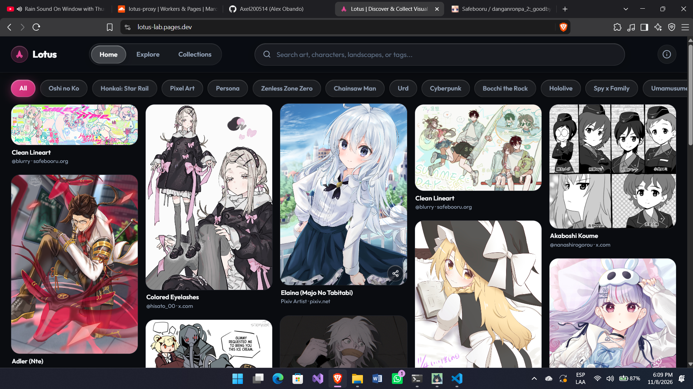
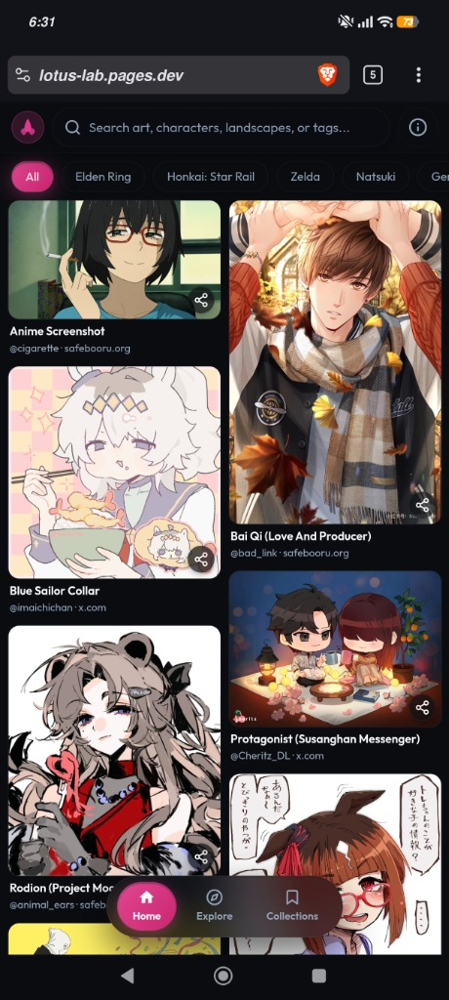
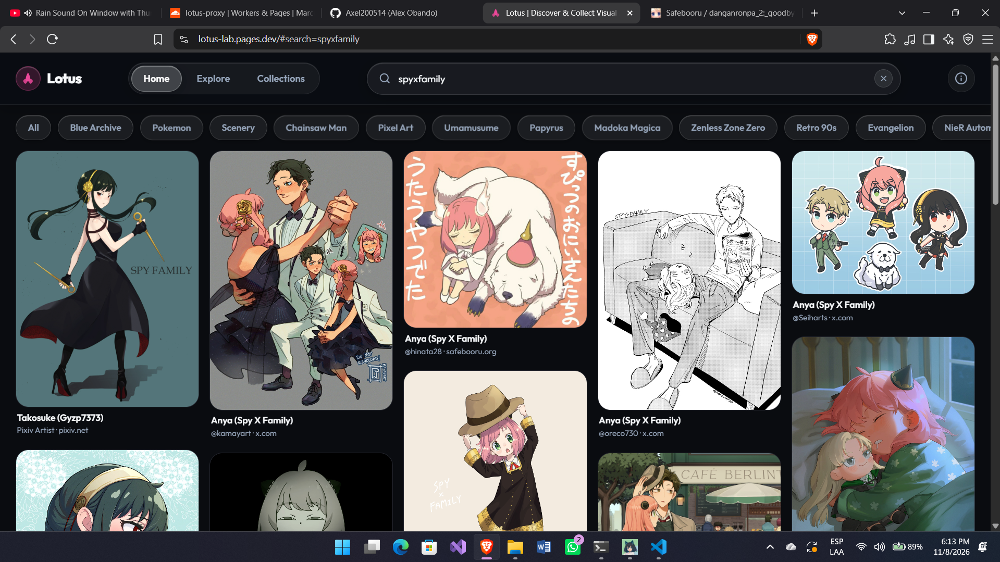
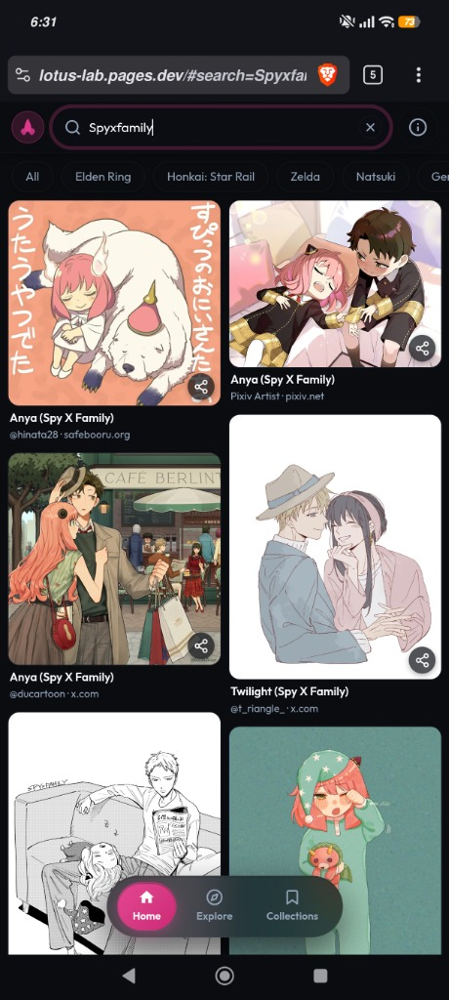
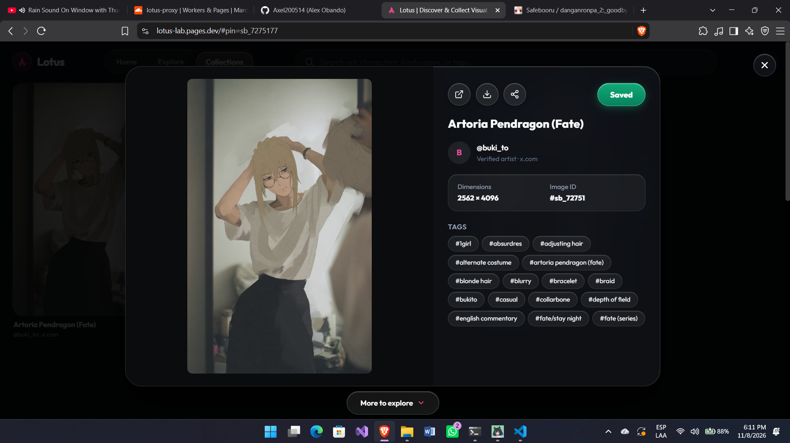
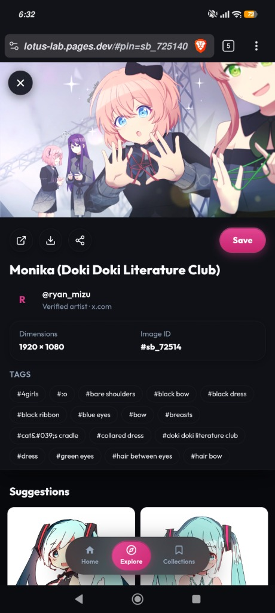
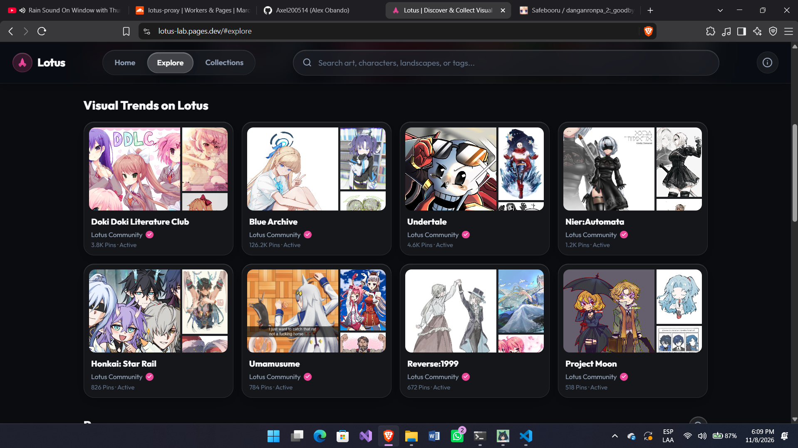
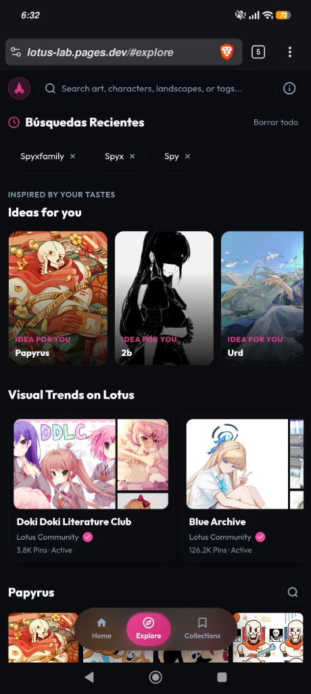
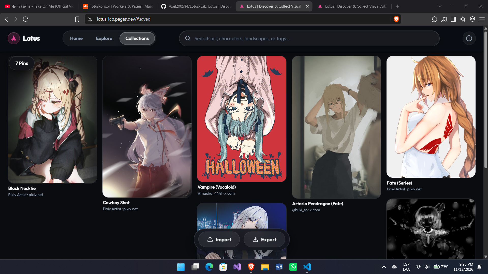
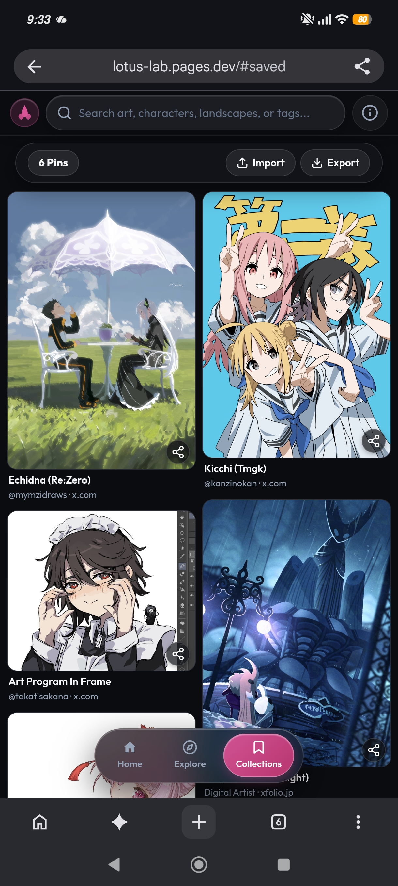

# Lotus

Lotus is a modern, high-performance visual art discovery client inspired by Pinterest. It enables users to explore trending anime and video game franchises, search community tags with edge-accelerated alias resolution, filter artwork, save favorite pins locally, and view creator attribution.

🌐 **Live Demo**: [https://lotus-lab.pages.dev/](https://lotus-lab.pages.dev/)

> **Disclaimer**: This is a personal, non-commercial educational study project built to demonstrate high-performance Vanilla JavaScript SPA architecture, clean code, edge computing with Cloudflare D1, and GPU-accelerated rendering. It does not host, store, or sell any media files; all metadata is parsed from public imageboard APIs (Safebooru).

---

## Interface & Preview

### 1. Main Feed (Masonry Layout)
Staggered multi-column gallery with infinite scrolling, category chips, and zero layout shift (CLS).

| Desktop View | Mobile View |
| :---: | :---: |
|  |  |

### 2. Search & Tag Filtering
Real-time search with natural language query normalization, interactive category chips, and edge D1 alias mapping.

| Desktop View | Mobile View |
| :---: | :---: |
|  |  |

### 3. Pin Detail & Artist Attribution
Fullscreen modal inspection with real image dimensions, verified artist links (Pixiv, Twitter / X, ArtStation), direct download, related suggestions engine, and one-tap bookmarking.

| Desktop View | Mobile View |
| :---: | :---: |
|  |  |

### 4. Explore & Visual Trends
Curated franchise boards with live pin counters, recent search history, and personalized idea recommendations.

| Desktop View | Mobile View |
| :---: | :---: |
|  |  |

### 5. Collections (Saved Pins & Export/Import)
Private, local device pin bookmarking stored via `localStorage` with human-readable `.json` export/import and dopamine toast notifications.

| Desktop View | Mobile View |
| :---: | :---: |
|  |  |

---

## Key Features

- **Cloudflare Edge & D1 Architecture**: Serverless Cloudflare Worker proxy paired with a Cloudflare D1 SQL database for real-time tag alias resolution, `D1-HIT` query caching, and rate-limit defense.
- **Fluid Masonry Feed**: Responsive, staggered multi-column image grid with infinite scroll and native `<template>` cloning with `DocumentFragment` batch insertion.
- **Advanced Related Pins Engine**: Semantic character and series anchor resolution with 0-indexed pagination, ensuring accurate suggestions for both trending and rare tags.
- **Lightweight Collection Portability**: Export and import your entire collection anytime as a human-readable, compact `.json` file (~45–65 KB for 200 pins) with zero server dependency.
- **Dopamine Toast Feedback**: Tactile spring-animated toasts with GPU progress bar drains, tap-to-dismiss, and hover-pause for collection actions.
- **Responsive Controls**: Floating collection actions centered at the bottom on PC and Tablet, and streamlined sticky top bar on mobile devices.
- **100% GPU Compositor Animations**: Animations strictly isolate `transform` and `opacity` properties at 60–120 FPS, preventing CPU layout reflows and paint bottlenecks.
- **Zero-Telemetry Privacy**: No user accounts, database tracking, or third-party cookies. All saved pins, history, and preferences live 100% on your device in `localStorage`.

---

## Tech Stack

- **Frontend Core**: Vanilla JavaScript (ES Modules, modern ES2022+)
- **Architecture**: Single Page Application (SPA) with Hash-based Router
- **Edge Backend**: Cloudflare Workers (Serverless reverse proxy & download streamer)
- **Database**: Cloudflare D1 (Serverless SQLite at the edge for tag aliases and query caching)
- **DOM Engine**: Native `<template>` element cloning and `DocumentFragment` batch insertions
- **Styling**: Modern CSS3 (Custom Properties / CSS Variables, Flexbox, Multi-column CSS layouts, Media Queries)
- **Rendering & Performance**: Native `loading="lazy"` and `decoding="async"`, 100% GPU compositor-driven animations
- **Typography**: Local Outfit font family (Light, Regular, SemiBold, ExtraBold)
- **State & Storage**: Client-side `localStorage` with versioned cache busting and strict payload validation
- **Data Source**: Safebooru Public DAPI (`post` and `tag` endpoints)

---

## Project Structure

```text
Lotus-Lab/
├── index.html                      # Main entry point and HTML templates
├── legal.html                      # Legal, Privacy, and DMCA Transparency Center
├── README.md                       # Architectural documentation
├── docs/                           # Visual preview assets and screenshots
├── styles/                         # Global design system & styles
│   ├── Fonts/                      # Outfit font files (.ttf)
│   ├── variables.css               # Design tokens, color palette, and breakpoints
│   ├── reset.css                   # Cross-browser normalization
│   ├── layout.css                  # Header, navigation, and masonry grid layouts
│   ├── utilities.css               # Helper utility classes
│   └── legal.css                   # Dedicated legal page styling
├── modules/
│   ├── core/                       # Core infrastructure services
│   │   └── services/
│   │       └── http.service.js     # Centralized HTTP request wrapper
│   ├── shared/                     # Shared UI components and utilities
│   │   ├── components/             # Navbar, Modal, Loader
│   │   ├── models/                 # Data entities (PinModel)
│   │   └── utils/                  # StorageUtils, UI dopamine toasts, helpers
│   ├── pins/                       # Pin masonry grid and card components
│   ├── explore/                    # Visual trend boards and ideas carousel
│   ├── search/                     # Search bar and tag chip filters
│   └── saved/                      # Saved pins collection and import/export
└── app/
    ├── app.js                      # Application bootstrap and lifecycle
    ├── app.routes.js               # Route mapping and hash router
    └── app.config.js               # API endpoints, Live/Local toggle, and routes
```

